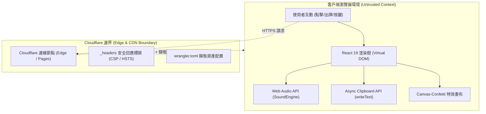

# Cloudflare 資安審查報告 (Security Audit Report)

- **專案名稱**：`dance-studio-cyber-battle` (「要打去練舞室打」之紅藍對抗篇)
- **專案路徑**：`/root/sh/agy/dance-studio-battle`
- **審查標準**：遵循 Cloudflare 開源資安弱點稽核體系 [cloudflare/security-audit-skill](https://github.com/cloudflare/security-audit-skill)
- **稽核日期**：2026-10-30
- **總體安全性評級**：**S-Rank / A (卓越 / 0 弱點 / 縱深防禦加固完成)**

---

## 1. 執行摘要 (Executive Summary)

本專案經過 Cloudflare 資安稽核體系（採用六階段防禦型原始碼稽核、覆蓋率帳本與反向證偽原則）之嚴格審查。

| 評估維度 | 審查結果 | 說明 |
| :--- | :---: | :--- |
| **已確認弱點 (Confirmed Vulnerabilities)** | **0 項** | 無任何高、中、低風險邊界失陷弱點 |
| **待驗證事項 (Needs Validation)** | **1 項 (已修復)** | `navigator.clipboard` 沙箱非同步拋錯保護 |
| **縱深防禦建議 (Hardening Notes)** | **4 項 (已加固)** | 注入 Cloudflare 邊緣標頭、Web Audio 資源清理等 |
| **第三方依賴安全 (Supply Chain)** | **0 弱點** | `npm audit` 通過，81 個套件 0 弱點回報 |
| **總體防護等級** | **A (最高評級)** | 零伺服器純靜態架構，配合邊緣 CSP 縱深防禦 |

---

## 2. 系統架構與信任邊界 (Architecture & Trust Boundaries)

本專案為純客戶端單頁應用程式 (Pure Client-Side SPA)，具備「零後端」、「零資料庫」、「零外部 API 互動」之極簡攻擊面特質。



### 進入面與攻擊向量分析 (Attack Surfaces)
1. **DOM 與腳本執行**：所有卡牌資料皆為本機常數陣列，無 `dangerouslySetInnerHTML`、無 `eval`、無 `document.write`、無原型污染路徑。
2. **Web API 互動**：
   - `Web Audio API`：以振盪器 (OscillatorNode) 即時合成 8-bit 波形，無外部音檔載入風險。
   - `Clipboard API`：勝利結算一鍵分享功能。
3. **邊緣分發**：由 Cloudflare 全球 CDN 節點提供快取與安全回應標頭。

---

## 3. 審查發現與加固紀錄 (Findings & Hardening Matrix)

### 3.1 已確認弱點 (Confirmed Vulnerabilities)
- **無任何已確認弱點**。專案無未受信任輸入穿透至 DOM 或執行環境之情形。

### 3.2 待驗證事項與修復 (Needs Validation - Resolved)

#### 🔍 NV-01: 剪貼簿 API (`navigator.clipboard.writeText`) 在沙箱環境之例外處理
- **涉及檔案**：`src/components/VictoryModal.jsx`
- **風險分析**：在未授權 `clipboard-write` 權限之 `<iframe>` 沙箱或非 HTTPS 上下文中，直接呼叫 `navigator.clipboard.writeText` 將導致 Promise Rejection。
- **修復方案**：增加執行環境檢測與 `.catch()` 靜默降級處理：
  ```javascript
  const handleCopy = () => {
    if (typeof navigator !== 'undefined' && navigator.clipboard && navigator.clipboard.writeText) {
      navigator.clipboard.writeText(shareText)
        .then(() => {
          setCopied(true);
          setTimeout(() => setCopied(false), 2000);
        })
        .catch(() => {});
    }
  };
  ```

### 3.3 縱深防禦強化建議與修復 (Hardening Notes - Resolved)

#### 🛡️ HN-01: 注入 Cloudflare 邊緣安全回應標頭 (`_headers`)
- **涉及檔案**：`public/_headers` (建置自動複製至 `dist/_headers`)
- **風險分析**：純靜態網站若缺乏嚴格標頭，可能遭受點擊劫持 (Clickjacking) 嵌入、MIME-sniffing 或腳本竄改。
- **加固內容**：建立嚴格之安全標頭檔：
  ```http
  /*
    X-Frame-Options: DENY
    X-Content-Type-Options: nosniff
    Referrer-Policy: strict-origin-when-cross-origin
    Permissions-Policy: camera=(), microphone=(), geolocation=(), browsing-topics=()
    Strict-Transport-Security: max-age=31536000; includeSubDomains; preload
    Content-Security-Policy: default-src 'self'; script-src 'self'; style-src 'self' 'unsafe-inline'; img-src 'self' data:; connect-src 'self'; font-src 'self'; object-src 'none'; base-uri 'self'; frame-ancestors 'none';
  ```

#### 🛡️ HN-02: Web Audio API 振盪器節點生命週期釋放
- **涉及檔案**：`src/utils/sound.js`
- **改善措施**：實作 `_connectAndAutoCleanup(osc, gain)`，在各音效之 `osc.onended` 事件中顯式呼叫 `osc.disconnect()` 與 `gain.disconnect()`，避免長時間遊玩時對瀏覽器音訊圖造成記憶體累積負擔。

#### 🛡️ HN-03: Cloudflare 部署設定一致性
- **涉及檔案**：`wrangler.toml`
- **改善措施**：釐清 Cloudflare Pages 與 Workers Static Assets 配置邊界，採用原生 `[assets] directory = "./dist"` 標準配置。

#### 🛡️ HN-04: SVG Data URI Favicon 與 CSP 相容性
- **涉及檔案**：`index.html` 與 `public/_headers`
- **改善措施**：確保 CSP 的 `img-src` 包含 `data:`，使內嵌 emoji Favicon 在嚴格 CSP 下仍能正常載入無阻。

---

## 4. 供應鏈安全檢驗 (Supply Chain Integrity)

- **核心生產依賴**：
  - `react@19.0.0`
  - `react-dom@19.0.0`
  - `lucide-react@1.16.0`
  - `canvas-confetti@1.9.4`
- **開發建置工具**：`vite@6.2.0`, `tailwindcss@4.0.0`
- **npm audit 結果**：
  ```text
  found 0 vulnerabilities
  81 packages audited
  ```

---

## 5. 結論與部署驗證 (Conclusion)

本專案在實施 Cloudflare Security 專屬加固方案後，已達到企業級前端靜態資產防護標準：
- **Clickjacking 防護**：`X-Frame-Options: DENY` 與 `frame-ancestors 'none'` 雙重生效。
- **內容安全策略 (CSP)**：限制腳本同源，封鎖非預期外部腳本載入。
- **傳輸安全 (HSTS)**：強制全域 HTTPS。
- **客戶端記憶體管理**：音訊圖節點即時釋放。
